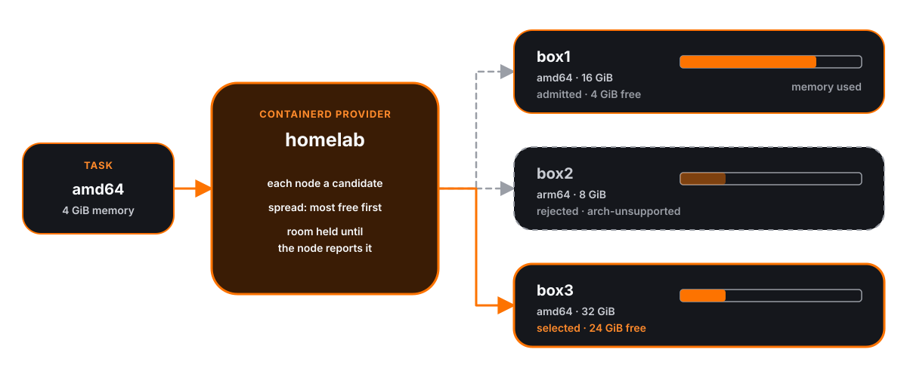

`vagabond agent` runs on a node you own, apart from the server. It dials the
server's `agent_bind` address, registers the node into a named pool, and runs
the workloads the server sends it with the node's executors: as containers on
the node's containerd ([containerd](containerd.md)), and, with `-firecracker`,
in Firecracker microVMs ([Firecracker](firecracker.md)). The server schedules onto the
pool's nodes through providers of type `containerd` and `firecracker`, each
node a candidate of its own. `vagabond node status` lists the nodes connected
now and how much of each is in use.

Workloads belong to containerd and vagabond-firecracker, not to the agent
process: they keep running when the agent stops or loses the server, and the
agent finds them again when it starts.

## Requirements

| Requirement | Checked at | Failure |
|---|---|---|
| Linux with cgroup v2 (unified hierarchy) | startup | [Startup errors](#startup-errors) |
| Read access to `/proc/meminfo` and `/proc/self/cgroup` | startup | [Startup errors](#startup-errors) |
| Permission to create cgroups under its own (no `-cgroup-parent`) | startup | [Startup errors](#startup-errors) |
| `-cgroup-parent` exists and can parent workloads | first `Submit` | `Internal` `creating the task: ...` |
| containerd reachable on `-containerd` | startup | |
| `-data-dir` writable | startup | |
| With `-firecracker`: containerd's devmapper snapshotter loaded | startup | [Startup errors](#startup-errors) |
| With `-firecracker`: vagabond-firecracker answering on its socket | startup | [Startup errors](#startup-errors) |
| TCP reach to the server's `agent_bind` | after startup, retried | `connecting to the server` warnings |

The agent needs no inbound port. The server calls it back down the
connection the agent opened.

## Flags

```bash
vagabond agent -server 10.0.0.5:4748 -pool homelab -label gpu=no -memory 12288 \
  -tls-ca /etc/vagabond/ca.pem -tls-cert /etc/vagabond/box1.pem -tls-key /etc/vagabond/box1-key.pem
```

| Flag | Default | Description |
|---|---|---|
| `-server <addr>` | `127.0.0.1:4748` | The server's `agent_bind` address, `host:port`. |
| `-pool <name>` | `default` | Pool the node joins. Must match the `pool` of a `containerd` or `firecracker` provider on the server to receive work. |
| `-name <name>` | the certificate's common name with TLS, else the hostname | Node name. Unique per server: an agent registering under a name already connected replaces that connection. With TLS it must match the certificate. |
| `-tls-ca <path>` | none | CA file, or directory of them, the server's certificate chains to. `-tls-ca`, `-tls-cert` and `-tls-key` are all set or none. See [Security](#security). |
| `-tls-cert <path>` | none | This agent's certificate. Its common name is the node's name. |
| `-tls-key <path>` | none | This agent's private key. |
| `-tls-server-name <name>` | host part of `-server` | Name the server's certificate must carry. Needs the three `-tls-*` flags. |
| `-label <key>=<value>` | none | Node label, repeatable. Published to constraints as `node.label.<key>`. A repeated key, an empty key or a value without `=` is a flag error. |
| `-cpu <millicores>` | `0` (no cap; negative is the same) | Upper bound on capacity CPU. |
| `-memory <MiB>` | `0` (no cap; negative is the same) | Upper bound on capacity memory. |
| `-containerd <path>` | `/run/containerd/containerd.sock` | containerd's socket. |
| `-firecracker` | off | Runs workloads in microVMs as well as containers, through a [vagabond-firecracker](firecracker.md) the agent starts with its socket, records and jails under `<data-dir>/firecracker`, their images' snapshots in the containerd namespace `vagabond-firecracker`. The agent stops when the daemon exits, and the daemon with the agent. |
| `-firecracker-uid <uid>`, `-firecracker-gid <gid>` | `990` | User and group Firecracker runs as. Give them to nothing else on the node. |
| `-firecracker-uplink <interface>` | the default route's | Interface microVM traffic leaves through, behind NAT. |
| `-data-dir <path>` | `/var/lib/vagabond` | Workload output, under `<data-dir>/logs`. Created mode `0750` if missing. In a container it must be the same path inside and out. |
| `-max-log-mib <MiB>` | `16` | How much of each workload's output the node keeps, on both executors; the front of longer output is freed in 256 KiB chunks. Set it to at least the server's `max_log_mib`, or the server stores only what the node kept. At least `1`. |
| `-cgroup-parent <path>` | empty | cgroup v2 path to create workloads under, prepared by the operator. Skips [cgroup delegation](#cgroup-delegation). |
| `-log-level <level>` | `info` | `debug`, `info`, `warn` or `error`. Logs are text to stderr. |

The full CLI reference is in [CLI](cli.md).

### Startup sequence

1. Parse flags; with `-tls-*`, load the certificate, key and CA and take the
   node's name from the certificate; parse the log level.
2. Read the node: architecture, host CPU and memory, the agent's cgroup and
   the limits above it ([Capacity](#capacity)).
3. Delegate the agent's cgroup, unless `-cgroup-parent` is set
   ([cgroup delegation](#cgroup-delegation)).
4. Connect to containerd and create `<data-dir>/logs`.
5. With `-firecracker`, start vagabond-firecracker, its log on the agent's
   stderr, and wait up to 30s for it to serve; then connect to containerd
   again for the `vagabond-firecracker` namespace.
6. Re-arm the timeout of every workload already in the `vagabond` namespace
   ([Agent restarts](containerd.md#agent-restarts)).
7. Log the node, then ask each executor what it is: containerd answers by its
   version; vagabond-firecracker by `Info`, once containerd's devmapper
   snapshotter is found loaded. What they answer, each executor's name and
   overhead, is what the node registers.
8. Dial the server and stay connected until `SIGINT` or `SIGTERM`. Either
   signal closes the session and exits 0; workloads keep running.

```text
level=INFO msg=node name=box1 pool=homelab cpu=4000 memory=12288 cgroup=/system.slice/vagabond-agent.service
level=INFO msg=connected server=10.0.0.5:4748 name=box1 pool=homelab
```

Steps 1 to 7 exit with status 1 on failure, before the node registers. A
server that cannot be reached is not a startup failure; the agent keeps
retrying.

## Capacity

Capacity is what the agent reports it may use, in millicores and MiB. Each
dimension is the smallest of:

| Source | CPU | Memory |
|---|---|---|
| Host | CPUs available to the process * 1000 | `MemTotal` from `/proc/meminfo`, kB / 1024 |
| cgroup chain | `cpu.max` quota * 1000 / period, tightest of the agent's cgroup and every ancestor to the root | `memory.max` bytes / 2^20, tightest of the chain |
| Flags | `-cpu` | `-memory` |

- A `cpu.max` or `memory.max` of `max`, or a file that does not exist, is no
  limit. A flag of `0` or less is no cap.
- The chain is read from the agent's own cgroup, also when `-cgroup-parent` is
  set.
- Capacity is read once at startup. Changing a limit or a flag takes an agent
  restart.

**Example:** a host with 8 CPUs and `MemTotal: 32791612 kB`, the agent in a
systemd unit with `CPUQuota=400%` and `MemoryMax=16G`, started with
`-memory 12288`:

| Dimension | Host | cgroup chain | Flag | Capacity |
|---|---|---|---|---|
| CPU | 8000 | `400000 100000` = 4000 | none | **4000** |
| Memory | 32023 | 17179869184 B = 16384 | 12288 | **12288** |

Workloads are created under the agent's cgroup, so the kernel holds their sum
to the cgroup limits as well as to the per-workload limits described in
[Workloads](#workloads). `-cpu` and `-memory` are enforced only by the room
checks on the agent and the server, not by the kernel. With `-cgroup-parent`,
workloads are under that parent instead, so its limits apply, not those of the
agent's chain that capacity is read from.

## cgroup delegation

cgroup v2 lets a cgroup either hold processes or hand controllers to children,
not both. At startup the agent prepares its own cgroup to parent workloads:

1. Read its cgroup from the `0::` line of `/proc/self/cgroup`. No such line is
   a cgroup v1 host.
2. If its cgroup already ends in `/agent` (an agent restarted inside its own
   leaf), use the parent of that.
3. Refuse the root cgroup `/`.
4. Create the child `<cgroup>/agent`.
5. Move its own PID into `<cgroup>/agent`.
6. Enable the `cpu` and `memory` controllers for `<cgroup>`, in the
   `cgroup.subtree_control` of each ancestor from the root down to
   `<cgroup>`'s parent. `<cgroup>`'s own `cgroup.subtree_control` is written by
   runc, which enables the available controllers along a workload's cgroup path
   when it creates it; step 5 leaves `<cgroup>` without processes so it can.
7. Create every workload at `<cgroup>/<execution-id>`.

With `-cgroup-parent`, steps 2 to 6 are skipped and workloads are created at
`<cgroup-parent>/<execution-id>`. Step 1 still runs as part of reading
capacity, so a cgroup v1 host is refused either way. The agent neither checks
nor prepares the parent; runc enables controllers along the path when it
creates each workload. A parent that holds processes cannot pass controllers to
children, and the first `Submit` fails `creating the task: ...`.

### Startup errors

| Condition | Error |
|---|---|
| cgroup v1 host (no `0::` line in `/proc/self/cgroup`) | `Reading the node: the host is not on cgroup v2, which the agent requires` |
| `/proc/self/cgroup` unreadable | `Reading the node: reading the agent's cgroup: ...` |
| `/proc/meminfo` unreadable | `Reading the node: reading host memory: ...` |
| `MemTotal` missing or unparsable | `Reading the node: no MemTotal in /proc/meminfo` or `... parsing MemTotal: ...` |
| `cpu.max` or `memory.max` unreadable or unparsable | `Reading the node: reading sys/fs/cgroup/<path>/<file>: ...` or `... parsing sys/fs/cgroup/<path>/cpu.max: ...` |
| Agent's cgroup is `/` (container without `--cgroupns=host`) | `the agent's cgroup is the root. In a container, run it with --cgroupns=host so it sees its real cgroup, or pass -cgroup-parent` |
| Agent's cgroup path not clean and absolute | `loading cgroup <path>: cgroups: invalid group path` |
| Creating the leaf, moving into it, or enabling controllers is refused | `cannot manage cgroups under <path>: <cause>. Under systemd, set Delegate=yes on the agent's unit; in a container, mount /sys/fs/cgroup writable with --cgroupns=host` |
| Socket missing or unreachable | `containerd at <socket> does not answer: ...` |
| `-containerd` not a usable address | `connecting to containerd at <socket>: ...` |
| `<data-dir>/logs` cannot be created | `creating the log directory: ...` |
| containerd cannot list containers | `Finding workloads from before: listing containers: ...` |
| `-firecracker` given, containerd has no devmapper snapshotter | `containerd at <socket> has no devmapper snapshotter` |
| `-firecracker` given, devmapper failed to load (no thin pool, bad config) | `containerd's devmapper snapshotter did not load: <containerd's reason>` |
| `-firecracker` given, vagabond-firecracker not serving | `vagabond-firecracker at <socket> does not answer: dialling vagabond-firecracker at <socket>: ...` |
| Bad `-log-level` | `Invalid -log-level "<value>": use debug, info, warn or error.` |
| `-tls-ca`, `-tls-cert`, `-tls-key` partly set | `-tls-ca, -tls-cert and -tls-key go together: set all three or none` |
| `-tls-server-name` without the other three | `-tls-server-name needs -tls-ca, -tls-cert and -tls-key` |
| Certificate or key unreadable or mismatched | `loading the certificate <cert>: ...` |
| CA missing or not PEM | `loading the CA from <path>: ...` |
| Certificate without a common name | `the agent's certificate has no common name` |
| `-name` differs from the certificate | `-name "<name>" does not match the certificate's common name "<cn>"` |
| TLS set and `-server` has no port | `address <server>: missing port in address` |

## Deployment

The agent needs root or equivalent: containerd's socket is root-owned, and
delegation writes to `/sys/fs/cgroup`.

### systemd

```ini
[Unit]
Description=Vagabond agent
After=network-online.target containerd.service
Wants=network-online.target
Requires=containerd.service

[Service]
ExecStart=/usr/local/bin/vagabond agent -server 10.0.0.5:4748 -pool homelab \
  -tls-ca /etc/vagabond/ca.pem -tls-cert /etc/vagabond/box1.pem -tls-key /etc/vagabond/box1-key.pem
Delegate=yes
CPUQuota=400%
MemoryMax=16G
KillMode=process
Restart=always
RestartSec=5

[Install]
WantedBy=multi-user.target
```

| Setting | Why |
|---|---|
| `Delegate=yes` | Lets the agent create and manage cgroups below the unit's. Without it, steps 4 to 6 of delegation fail. |
| `CPUQuota=`, `MemoryMax=` | Become the unit cgroup's `cpu.max` and `memory.max`, and so the node's capacity. Optional. |
| `KillMode=process` | Workload processes live in the unit's cgroup subtree. With the default `control-group`, stopping or restarting the unit kills every workload with it. |

With `-firecracker`, add `After=` and `Requires=` on vagabond-firecracker's
unit too, so the agent starts once the daemon serves
([Deployment](firecracker.md#deployment)).

### Container

The agent in a container drives the host's containerd, so workloads run on the
host, not inside the agent's container.

```bash
docker run -d --name vagabond-agent --restart unless-stopped \
  --privileged --cgroupns=host \
  -v /run/containerd/containerd.sock:/run/containerd/containerd.sock \
  -v /var/lib/vagabond:/var/lib/vagabond \
  -v /etc/vagabond:/etc/vagabond:ro \
  --cpus 4 --memory 16g \
  <image-with-vagabond> agent -server 10.0.0.5:4748 -pool homelab \
    -tls-ca /etc/vagabond/ca.pem -tls-cert /etc/vagabond/box1.pem -tls-key /etc/vagabond/box1-key.pem
```

| Setting | Why |
|---|---|
| containerd socket mounted | The agent creates workloads through it. |
| `--cgroupns=host` | `/proc/self/cgroup` must show the host path of the container's cgroup, since containerd places workloads by that path. Otherwise the agent sees `/` and refuses to start. |
| `--privileged` | Mounts `/sys/fs/cgroup` writable, for delegation. |
| `-data-dir` mounted at the same path | containerd on the host writes workload output to the path the agent names, and the agent reads it back from the same path. |
| `--cpus`, `--memory` | Become the container cgroup's limits, and so the node's capacity. Optional. |
| `/etc/vagabond` mounted read-only | The CA and the node's certificate and key. The node's name comes from the certificate, not the container's hostname, which is its ID and changes when the container is recreated. |
| With `-firecracker`: `--pid=host` and `/dev` mounted | Each record keeps Firecracker's host pid, so a restarted daemon finds it, and the microVMs outlive the container; the devmapper devices the agent's snapshots appear as are made after the container started. amd64 images only. |

### Nomad

The agent has no Nomad-specific behaviour. As a `raw_exec` task it needs the
same delegation as any process; as a container task, the container settings
above. Capacity comes from the task's cgroup chain, so set `-cpu` and
`-memory` when that chain carries no `cpu.max` or `memory.max`.

```hcl
job "vagabond-agent" {
  type = "system"

  group "agent" {
    task "agent" {
      driver = "raw_exec"

      config {
        command = "/usr/local/bin/vagabond"
        args = [
          "agent",
          "-server", "10.0.0.5:4748",
          "-pool", "homelab",
          # Each Nomad client holds its own node certificate at these paths;
          # the node's name is the certificate's common name.
          "-tls-ca", "/etc/vagabond/ca.pem",
          "-tls-cert", "/etc/vagabond/node.pem",
          "-tls-key", "/etc/vagabond/node-key.pem",
          "-cpu", "4000",
          "-memory", "8192",
        ]
      }
    }
  }
}
```

### Server side

The server listens for agents on `agent_bind`, loopback-only by default. For
agents on other hosts, bind an address they can reach, with `agent_tls`:

```hcl
server {
  agent_bind = "10.0.0.5:4748"   # default "127.0.0.1:4748"

  agent_tls {
    cert = "/etc/vagabond/agents/server.pem"
    key  = "/etc/vagabond/agents/server-key.pem"
    ca   = "/etc/vagabond/agents/ca.pem"
  }
}
```

See [`agent_tls` block](configuration.md#agent_tls-block) and
[Security](#security). A listen failure stops the server with
`listening for agents on <addr>: ...`, an unreadable `agent_tls` certificate or
key with `loading the certificate <cert>: ...`, an unreadable CA with
`loading the CA from <path>: ...`, and an `agent_tls` block with no `ca` with
`Missing agent CA`. Shutdown closes the listener and every
agent session; agents log `lost the server` and keep dialing.

## Connection and reporting

The agent holds one connection to the server. On it, the agent registers its
node with `Node.Register`, and re-sends the same full report:

| When | Why |
|---|---|
| On connecting | The server learns the node and every workload it still holds. |
| After `Submit` starts a workload | Room taken. |
| After `Cancel` or `Release` | Room freed, workload gone. |
| Every 10 seconds | Catches a workload that finished on its own. |

Signals are coalesced: several changes while a report is pending send one
report. A failed periodic report is logged as `reporting workloads` and not
retried; the next carries everything. The server answers every report with
the held workloads it has no use for, which the agent releases; see
[Releasing what nothing needs](#releasing-what-nothing-needs).

The connection closing is the only liveness signal; there is no heartbeat of
Vagabond's own. yamux runs with its defaults on both sides: each pings the
other every 30 s and closes the session when a ping goes unanswered for 10 s,
so a peer that vanishes is noticed within about 40 s. A stream the peer does
not acknowledge within 75 s also closes the session. TCP keepalives are Go's
defaults. When the session closes, the server removes the node
(`node disconnected`) and the agent dials again.

**Reconnect backoff:**

| Setting | Value |
|---|---|
| First wait | 1 s |
| Growth | doubles per failed attempt |
| Maximum | 30 s |
| Reset | to 1 s after a session that registered and later dropped |

A dial or first registration that fails logs
`connecting to the server server=... error=... retry=<wait>`. A session that
was up and dropped logs `lost the server`. A dial has no timeout of its own: an
address that drops packets fails after the kernel's TCP connect timeout, about
2 minutes with Linux defaults. The agent's TLS handshake has none either; a
vagabond server drops it after 10 s.

The server records each node as it arrives (`node registered node=... pool=...
address=... cpu=... memory=... held=<n>`). Later reports from the same
connection update the node silently. A report under a connected name from a
new connection closes the old connection and replaces it. A replacement, where
the new connection registers while the old one is still open, logs neither
`node registered` nor `node disconnected`.

Agent reporting is one of the loops listed in
[Background services](background-services.md).

## Pools



### Declaring a provider

A provider of type `containerd` or `firecracker` on the server runs work on
the nodes that joined its pool and run its executor: containers on a
`containerd` provider, microVMs on a `firecracker` one. Both take the same
settings.

```hcl
provider "homelab" {
  type = "containerd"

  config {
    pool      = "homelab"
    placement = "spread"
  }
}

provider "homelab-vm" {
  type = "firecracker"

  config {
    pool = "homelab"
  }
}
```

| Setting | Default | Meaning |
|---|---|---|
| `pool` | The provider's label | The agents it draws on: those started with `-pool <pool>` |
| `placement` | `spread` | How its nodes are ordered among equally scored candidates: `spread` puts the most free memory first, `pack` the least |

- The `config` block is optional. `credentials` are resolved but unused. It
  accepts the provider-level settings every provider does, such as quota
  `pool` blocks and `meta`; see
  [`provider` block](configuration.md#provider-block).
- Any other `placement` fails with the diagnostic `Unknown placement`:
  `Provider "<name>" sets placement to "<value>"; it is "spread" or "pack".`
- Only `vagabond server` can build one. Loading one elsewhere fails with the
  diagnostic `Agent nodes without a server`:
  `Provider "<name>" runs on agent nodes, which only vagabond server can reach.`
- `pool` defaults to the label, so a second provider on one pool, as
  `homelab-vm` above, sets it.
- With no connected nodes in its pool running its executor, the provider is
  unhealthy (`no nodes running <type> have joined pool "<pool>"`) and
  admission rejects it with `provider-unhealthy`. At server start this appears as
  `Some providers did not answer: ...`, which does not stop the server.
- An agent whose `-pool` no provider draws on still connects and appears in
  `node status`, but receives no work.
- Two providers may draw on one pool. A node's room is counted once, whichever
  provider places work on it, so a node running both executors shares its
  room between its containers and its microVMs.

### Joining

```bash
vagabond agent -server 10.0.0.5:4748 -pool homelab -label gpu=yes -label rack=a \
  -tls-ca /etc/vagabond/ca.pem -tls-cert /etc/vagabond/box1.pem -tls-key /etc/vagabond/box1-key.pem
```

A pool's membership is read live on every plan, not from the periodic
refresh: a node is schedulable as soon as it registers, and gone as soon as
its connection closes.

### Node attributes

Each node is one member of the provider, with its own capability snapshot:

| Attribute | Value |
|---|---|
| `provider.drivers` | `container` |
| `provider.architecture` | The agent binary's `GOARCH`, e.g. `amd64`, `arm64` |
| `provider.max_cpu` | Room left after the executor's overhead, millicores; `0` when full |
| `provider.max_memory` | Room left after the executor's overhead, MiB; `0` when full |
| `provider.internet` | `true` |
| `provider.private_network` | `true` |
| `provider.arbitrary_images` | `true` |
| `provider.isolation` | `container` on a `containerd` provider, `vm` on a `firecracker` one |
| `provider.estimated_cost` | `0` |
| `node.label.<key>` | Each `-label` |

No `provider.max_duration` is published: a node sets no duration limit.
Provider `meta` tags and quota are the provider's, shared by every node.

```hcl
constraint {
  attribute = "node.label.gpu"
  value     = "yes"
}
```

See [Attributes](job-specification.md#attributes).

### Admission

Each node is judged on its own, as if it were the whole provider, with its
own snapshot and labels plus the provider's quota, `meta`, health and the
job's allowlist. Every node that passes every check is a candidate of its
own. A task needing `arm64` and 8 GiB is not admitted because one node is
`arm64` and another has 8 GiB free.

When no node passes, the provider is rejected with the reason code of the
node that failed the fewest checks, ties to the first by name, its detail
prefixed `closest node <name>: `.

See [Admission](scheduling.md#admission) and
[Reason codes](scheduling.md#reason-codes).

### Placement

Ranking scores each node with its own labels, so a `node.label.*` affinity
puts the nodes carrying the label first ([Ranking](scheduling.md#ranking)).
Among equally scored candidates a provider's nodes keep its `placement`
order, ties to the first by name. `job plan` lists each node as
`<provider>/<node>`.

Dispatch takes the candidates in rank order. For a node:

1. Reserve the task's quota on the provider.
2. Reserve room on the node, in one locked step against the node's room,
   sized from the task's `resources` with **1000 millicores** for an unset or
   zero `cpu` and **1024 MiB** for an unset or zero `memory`, plus the
   overhead the node registered for the provider's executor: none for
   containerd, `--vmm-overhead` of memory for a microVM. A node with too
   little room left, or no longer connected, is refused: the quota is given
   back, nothing is recorded, no attempt is spent, and dispatch goes on to the
   next candidate, another node or another provider.
3. Record the execution with its node.
4. Send `Submit` to the node.

Every later call for the execution goes to the node its record names, after a
server restart as before it.

### Room

A node's room is:

```text
capacity - sum(what running workloads take) - sum(unexpired reservations not yet reported)
```

- What a workload takes is its declared size plus its executor's overhead,
  not live usage. Each workload is capped at that, so the sum is what the node
  can be asked for at once.
- A workload that has ended is held until released but no longer counts; a
  microVM counts until its Firecracker has exited.
- A workload not yet started counts as running.
- The agent and the server count room the same way, from the same reports.

### Reservations

A reservation holds room between placing a workload and the node reporting
it, so two dispatches on the same server cannot both take the last room.

| Event | Effect |
|---|---|
| Node reports holding the execution | Reservation dropped (the node's report covers it) |
| 2 minutes pass | Reservation dropped |
| Task does not translate, node refuses, or `Submit` fails | Reservation dropped |
| Execution released | Reservation dropped |

Reservations are in memory, per server process.

### Refusal and retry

The agent checks room itself, holding a lock to verify capacity and record an
in-flight reservation before starting the workload outside the lock: its
running and reserved workloads' declared sizes plus the new one must fit
capacity, and the reservation is dropped when Submit returns. A concurrent
submission for the same execution waits for the in-flight one to finish; a
resubmission of an execution the agent already holds always fits and starts
nothing new.

| Answer | Server does |
|---|---|
| `ResourceExhausted` (`the node has <cpu> millicores and <mem> MiB free; the workload needs <cpu> and <mem>`) | Drops the reservation; infrastructure failure `node <name>: rpc error: code = ResourceExhausted desc = ...`. |
| `FailedPrecondition` (`the node has no such executor: "<name>"`) | Drops the reservation; infrastructure failure, as for a node gone. |
| `InvalidArgument` (`invalid workload: image "<ref>": ...`) | Drops the reservation; internal failure `node <name>: ...`. No node could run it, so it is not sent anywhere else. |
| Any other error | Drops the reservation; infrastructure failure `node <name>: ...`. |
| Node disconnected between reserving and sending | Drops the reservation; infrastructure failure `node <name> is not connected`. |
| Task names no `image`, or its `env` or `timeout` does not evaluate | Drops the reservation; internal failure `task "<name>" names no image`, `task "<name>" env: ...` or `task "<name>" timeout: ...`, before anything is sent. Not sent anywhere else. |

The server's own room count normally refuses first, at
[Placement](#placement), without spending an attempt. An infrastructure
failure from `Submit` is a spent attempt: dispatch goes on to the next
candidate only when the task's `retry` block allows rerouting; see
[Dispatch](dispatch.md).

**Sizing in admission:** each node publishes the 1000 millicore / 1024 MiB
default as its default size, so admission checks a task that declares no
resources at the size placement will use. A full node publishes zero room and
is rejected with `resources-exceeded`.

### Node leaving mid-run

While a node is not connected, its executions cannot be asked about:

| Call | While the node is not connected |
|---|---|
| Status, Result, Cancel, StreamLogs | Infrastructure failure `node <name> is not connected` |
| Release | Succeeds without calling the node, which is told when it returns |

The runner records the failed Status as `lost` and answers the attempt, so
the task can reroute. `lost` is not terminal: the runner keeps polling, and
the execution keeps its charge and stays unreleased for as long as the node is
away, after a server restart as before it, since the record names the node. A
node that reconnects reports its workloads, and they finish normally. One that
never does is `failed` 24 hours after it became `lost`, charged as reserved
([Lost executions](dispatch.md#lost-executions)), and released.

### Releasing what nothing needs

Every report is answered with the held workloads the server has no use for,
and the agent releases each as its executor's `Release` does
([containerd](containerd.md#release), [Firecracker](firecracker.md#release)):

- one whose execution is released
- one no execution was recorded under, or whose ID is no execution's

A workload whose record the store cannot read is kept, so a server that
cannot reach its store releases nothing. The agent logs
`released a workload the server has no use for execution=<id>`; a failed one
warns `releasing a workload the server has no use for` and is answered again on
the next report.

## Workloads

Each workload runs on the executor its provider's type names:

| Provider type | Executor | Runs each workload |
|---|---|---|
| `containerd` | [containerd](containerd.md) | As a container on the node's containerd, sharing its kernel and network |
| `firecracker` | [Firecracker](firecracker.md) | In a Firecracker microVM with its own kernel, behind NAT |

Every executor keeps the same contract, which the server relies on:

| | Every executor |
|---|---|
| Idempotency | The execution ID: a second `Submit` of a held execution starts nothing |
| States | `accepted` until started, `running`, then `succeeded`, `failed` or `cancelled`; one gone after it started, without an exit, ends `failed` with no exit code |
| Output | Standard output and error together, the last `-max-log-mib` of it kept until `Release`, read from any byte offset; a read from before the kept part begins where that part does |
| Timeout | Measured from the saved start: `SIGTERM`, then `SIGKILL` 10 seconds later; ends `failed` |
| Cancel | `SIGTERM`, then `SIGKILL` 10 seconds later; ends `cancelled` whatever the exit |
| Release | Deletes everything kept for it; one not held is released already |
| Restarts | Workloads outlive the agent, which finds them again when it starts |

How each executor keeps it, and where it differs, is on its own page. A
microVM differs from a container in its own kernel, its network behind NAT,
its memory charged with Firecracker's overhead, and a workload that is not
PID 1, so `SIGTERM` ends a plain `sh -c` at once with 143.

## Node status

`vagabond node status` lists the nodes connected to the server now, sorted by
name.

```shell
$ vagabond node status
NAME  POOL     ADDRESS          ARCH   EXECUTORS               CPU USED    MEMORY USED    WORKLOADS  CONNECTED
box1  homelab  10.0.0.21:51234  amd64  containerd,firecracker  1500/4000m  2048/12288MiB  2          2026-09-28 14:02:11Z
box3  homelab  10.0.0.23:40112  arm64  containerd              0/8000m     0/15872MiB     0          2026-09-28 14:05:47Z
```

| Column | Meaning |
|---|---|
| `ADDRESS` | Where the agent connected from |
| `EXECUTORS` | What the node runs workloads with |
| `CPU USED`, `MEMORY USED` | What running workloads take and the server's reservations / capacity |
| `WORKLOADS` | Running workloads |
| `CONNECTED` | When this connection registered, UTC |

With no nodes it prints `No agent nodes are connected.`. Used figures are as
of the node's last report, plus the server's reservations not yet in it. The
server is read from `-address`, then `$VAGABOND_ADDR`, then
`http://127.0.0.1:4747`.

The same data is `GET /v1/nodes`; see [List nodes](api.md#list-nodes).

## Protocol

One TCP connection from agent to server, multiplexed with yamux. Each side
serves gRPC on the streams the other opens, so the server calls the agent
without the agent listening on anything.


Interactive version, with notes on each component:
[Agents and pools](https://vagabond.munchbox.cc/diagrams/agents/).

Package `vagabond.agent.v1`, defined in `internal/agentrpc/agent.proto`;
regenerate with `make generate`.

| Service | Served by | Called by |
|---|---|---|
| `Node` | server | agent |
| `AgentExecutions` | agent | server |

### RPCs

| RPC | Request | Response |
|---|---|---|
| `Node.Register` | `name`, `pool`, `labels`, `architecture`, `capacity` (cpu, memory), `version`, `held[]` (execution ID, what it takes, running), `executors[]` (`name`, `overhead`). Field 6, `runtimes`, is reserved | `release[]`: held execution IDs to release, empty when the server cannot tell |
| `AgentExecutions.Submit` | `execution_id`, `workload`: `image`, `command`, `args`, `env`, `working_dir`, `resources`, `timeout`, `executor`. Field 8, `runtime`, is reserved | `state`, `provider_id` |
| `AgentExecutions.Status` | `execution_id` | `state`, `provider_id`, `started_at`, `ended_at` |
| `AgentExecutions.Result` | `execution_id` | `exit_code` (unset if never exited), `duration`. Fields 3 and 4, which carried a tail of the output, are reserved |
| `AgentExecutions.Cancel` | `execution_id` | empty |
| `AgentExecutions.Release` | `execution_id` | empty |
| `AgentExecutions.StreamLogs` | `execution_id`, `offset` (bytes the server already has) | stream of `data` chunks from `offset`, polled every 250 ms until the workload ends or is released |

States travel as their names (`accepted`, `running`, `succeeded`, ...), and
the server refuses a name it does not know rather than record it. `executor`
is the provider's type, and names the executor that runs the workload.
`provider_id` from the agent is the execution ID, recorded as the execution's
provider ID; the node is recorded apart. Upgrade the server and its agents
together: a server from this release offers work only to nodes that register
executors, and an older agent refuses a workload naming one.

### Status codes

| Code | Returned by the agent when | Server maps it to |
|---|---|---|
| `ResourceExhausted` | `Submit` does not fit the node's room | Infrastructure failure ([Refusal and retry](#refusal-and-retry)) |
| `FailedPrecondition` | `Submit` names an executor the node does not run | Infrastructure failure |
| `InvalidArgument` | `Submit` of a workload no node could run, such as an image reference that does not parse | Internal failure, not rerouted |
| `NotFound` | No executor on the node holds the execution (`Status`, `Result`, `Cancel`, `StreamLogs`) | Unknown execution |
| `Internal` | Any other executor error: image pull, container create, a daemon not answering, `Result` before the workload finished | Infrastructure failure |
| Transport errors | Connection dropped mid-call | Infrastructure failure |
| `Canceled`, `DeadlineExceeded` | The server's call ended first, including a `Submit` waiting on another in flight for the same execution | Infrastructure failure |

A panic in a handler on either side, the agent's or the server's `Node`
service, answers `Internal` (`internal error in <method>`) and is logged at
error with its stack; the session and the process carry on.

## Security

| `agent_bind` | Agent connection | Who can register |
|---|---|---|
| Loopback: `localhost`, `127.0.0.0/8`, `::1` (default `127.0.0.1:4748`) | Plain TCP, or mutual TLS with `agent_tls` | Local agents, under any name |
| Anything else, including an empty host such as `:4748` | Mutual TLS. Without `agent_tls` the server refuses to start: `agent_bind <addr> is reachable beyond this machine: add an agent_tls block to the server block so agents must present a certificate, or bind to 127.0.0.1` | Agents with a certificate the CA signed, under its common name |

With mutual TLS:

- Both sides require TLS 1.3.
- The server gives each handshake 10 s. One that fails or does not finish is
  dropped and logged as `agent connection from=... error="TLS with <addr>: ..."`.
- The server presents its certificate and requires one from every agent,
  signed by `agent_tls.ca`. A connection without a certificate, or with one
  from another CA, fails the handshake and never registers.
- The node name is the certificate's common name. `-name` defaults to it, and
  the agent refuses to start with a `-name` that differs. The server refuses a
  registration under any other name with `PermissionDenied`, so only the
  holder of a node's certificate can replace it.
- The agent verifies the server's certificate against `-tls-ca`, for the name
  in `-tls-server-name` or the host of `-server`.
- A handshake the agent cannot complete is a failed dial, retried with backoff
  and logged as `connecting to the server ... error="TLS with <addr>: ..."`.

The server calls agents only over connections agents opened. Agents listen on
nothing.

### Certificates

One CA signs the server's agent-listener certificate and every agent's. Keep it
for agents only: API client certificates come from another CA, since a client
certificate this CA signed could register as a node named for it. See
[Deployment](deployment.md#network-exposure). With `openssl`:

```bash
# CA, kept off the nodes.
openssl req -x509 -new -nodes -newkey ec -pkeyopt ec_paramgen_curve:P-256 \
  -keyout ca-key.pem -out ca.pem -days 3650 -subj "/CN=vagabond agents CA"

# Server: the name agents dial must be a SAN.
openssl req -new -nodes -newkey ec -pkeyopt ec_paramgen_curve:P-256 \
  -keyout server-key.pem -out server.csr -subj "/CN=vagabond server"
openssl x509 -req -in server.csr -CA ca.pem -CAkey ca-key.pem -CAcreateserial \
  -out server.pem -days 825 \
  -extfile <(printf "subjectAltName=IP:10.0.0.5,DNS:vagabond.internal\nextendedKeyUsage=serverAuth")

# One per node: the common name is the node's name.
openssl req -new -nodes -newkey ec -pkeyopt ec_paramgen_curve:P-256 \
  -keyout box1-key.pem -out box1.csr -subj "/CN=box1"
openssl x509 -req -in box1.csr -CA ca.pem -CAkey ca-key.pem -CAcreateserial \
  -out box1.pem -days 825 -extfile <(printf "extendedKeyUsage=clientAuth")
```

Server:

```hcl
server {
  agent_bind = "0.0.0.0:4748"

  agent_tls {
    cert = "/etc/vagabond/agents/server.pem"
    key  = "/etc/vagabond/agents/server-key.pem"
    ca   = "/etc/vagabond/agents/ca.pem"
  }
}
```

Agent:

```bash
vagabond agent -server 10.0.0.5:4748 -pool homelab \
  -tls-ca /etc/vagabond/ca.pem \
  -tls-cert /etc/vagabond/box1.pem \
  -tls-key /etc/vagabond/box1-key.pem
```

- Keep `ca-key.pem` off the server and the nodes; it mints node identities.
- The agent's `-tls-*` flags are not read from `$VAGABOND_TLS_*`; those are for
  the client commands, whose certificates come from the API's CA.
- Certificates are read once at startup. Replacing one takes a restart of the
  server or the agent.
- There is no revocation list. To remove a node's access, issue new
  certificates from a new CA.

## Troubleshooting

| Symptom | Cause | Fix |
|---|---|---|
| `connecting to the server ... error="dialing <addr>: ... connection refused"` repeating | Server not listening there, or `agent_bind` still loopback | Set `agent_bind` to a reachable address; check `-server`. |
| Node absent from `node status` | Agent not connected; see its log | |
| Node listed, jobs never placed on it; plan shows `provider-unhealthy` or no node | `-pool` does not match the provider's `pool`, or the node does not run the provider's executor (see `EXECUTORS` in `node status`) | Match the names; start the agent with `-firecracker` for a `firecracker` provider. |
| Agent exits at startup: `vagabond-firecracker at <socket> does not answer` | The daemon not running, or not yet serving | Start vagabond-firecracker first; under systemd, order the agent after it. |
| Agent exits at startup: `has no devmapper snapshotter` or `devmapper snapshotter did not load` | containerd lacks a working devmapper thin pool | Configure one ([containerd's devmapper guide](https://github.com/containerd/containerd/blob/main/docs/snapshotters/devmapper.md)). |
| `closest node <name>: ...` in plan | No node passes admission | Read the reason; check `node.label.*` constraints and free room. |
| Dispatch reports `no node in pool "<pool>" has room for ...` | Every admitted node full, or reservations pending | Wait for work to finish or add capacity. Reservations expire after 2 minutes. |
| Two agents alternate in `node status`, both logging `lost the server` | Same `-name` on two hosts. The server logs nothing while they alternate. | Give each a unique `-name`. |
| Agent logs `connecting to the server ... registering: rpc error: code = Unavailable ...`; server logs `agent connection ... tls: first record does not look like a TLS handshake` | Agent started without `-tls-*` against a server with `agent_tls` | Pass `-tls-ca`, `-tls-cert` and `-tls-key`. |
| Node disk fills under containerd's root | Pulled images are never removed | `ctr -n vagabond images rm <ref>`. |
| `dropping the front of a workload's output error=... operation not supported` every 10 seconds | `-data-dir` is on a filesystem that cannot free part of a file, so logs grow until `Release` | Put `-data-dir` on ext4, XFS, btrfs or tmpfs. |
| `cannot manage cgroups under ...` at startup | cgroup not delegated | `Delegate=yes`, or privileged container with `--cgroupns=host`. |
| `the agent's cgroup is the root` at startup | Container without `--cgroupns=host` | Add it, or pass `-cgroup-parent`. |
| Workloads die when the agent restarts under systemd | `KillMode=control-group` kills the unit's subtree | `KillMode=process`. |
| Result has no output from a containerised agent | `-data-dir` path differs inside and outside the container | Mount it at the same path. |
| Executions still `lost` after a node went away | The node has not reconnected; they wait for it up to 24 hours | Check the agent starts on boot and can reach the server. |
| `Internal ... pulling <image>` | Image unreachable or private | The agent pulls from the registry on every new submission, without credentials; use an image the node can pull anonymously. |

Server-side log lines: `serving agents address=...` at start,
`node registered ...` per arrival, `node disconnected node=...` per departure,
`agent connection from=... error=...` when a session cannot be set up, and
`accepting agent connections failed, retrying error=...` per failed accept,
which is retried 5ms doubling to 1s.

## Testing

```bash
make executor-test       # both executors' tests, verbose
make executor-coverage   # the same, into executor-coverage.out, as CI runs it
```

Starts a containerd of its own, with the devmapper snapshotter on a thin pool
over loop devices, and a vagabond-firecracker beside it
(`scripts/executor-env.sh`), apart from anything the host runs. Then it builds
the executors' tests with `-race` and the `containerd` and `firecracker` build
tags into `bin/executor.test` as your user, and runs them with `sudo` and a
10 minute timeout, pulling `alpine:3.20`, in the `/vagabond-test` cgroup. The
environment is cleared after, pass or fail, and `executor-coverage` hands the
root-written profile back to your user. `make executor-env-down` clears what
an interrupted run left. It needs root, `/dev/kvm`, `containerd` and
`dmsetup`; the tests skip without the environment, which the make targets
always start.

CI's `firecracker` job runs `make executor-coverage` after the microVM tests
([Testing](firecracker.md#testing)). The profile joins the unit and
integration ones in SonarCloud.
